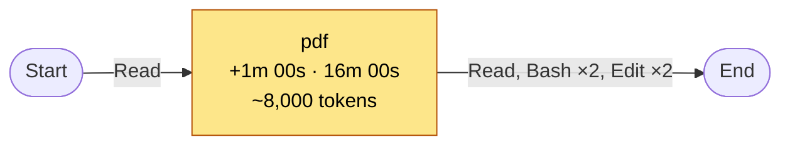
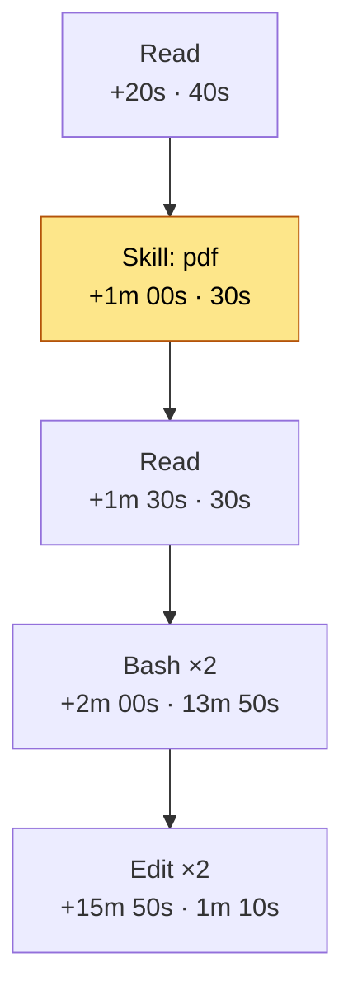

# Token window report: demo

- **Status:** closed
- **Session:** `S`   **Directory:** `/proj`
- **Started:** 2026-10-31 13:00:00   **Ended:** 2026-10-31 13:17:00
- **Total window time:** 17m 00s (active 4m 00s, idle 13m 00s, longest pause 13m 00s)
- **Claude Code mode:** default (asks before edits and commands)
- **Model:** claude-sonnet-5-5 → claude-opus-5-5 (at +15m 50s)
- **Effort level:** xhigh

## Tokens

- **Consumed (new):** 133,990 = output 10,450 + input 40 + cache write 123,500
- **Cache reads (re-sent context):** 111,460
- **Context size:** 20,000 → 12,500 (peak 46,500)
- **Activity:** 8 assistant message(s), 7 tool call(s), 1 completed turn(s)

## Estimated cost (API list-price equivalent)

- **Total:** $0.662 = output $0.195 + input $0.0001 + cache write $0.455 + cache read $0.012
- **Average per assistant message:** $0.083 over 8 priced message(s)
- **By model:** claude-opus-5-5 $0.475 (3 msg), claude-sonnet-5-5 $0.187 (5 msg)
- **Caching effect:** input side cost $0.468 instead of $0.612 without caching (saved $0.144, 24%)
- **Prices:** list prices from pricing.json (source: https://platform.claude.com/docs/en/about-claude/pricing, retrieved 2026-10-31). On a Pro/Max/Team subscription you are not billed per token; read this as what the same usage would cost at API prices.

## Configuration and caching

- **Prompt caching:** enabled (cache activity observed)
- **Cache TTL used (writes):** 5-minute 123,500, 1-hour 0
- **Cache hit rate:** 47% of input-side tokens were served from cache
- **Input-side cost, with vs without caching:** $0.468 vs $0.612 (24% lower; output excluded)
- **Thinking:** 8 of 8 assistant message(s) contained thinking blocks (thinking tokens are billed as output and are not reported separately)
- **Claude Code version:** 2.1.300   **Branch:** main   **Service tier:** standard
- **Token-related environment settings:** none set (defaults apply; settings.json-only keys such as `promptCacheTtl` or `effortLevel` are not visible to the hook)

## Other factors

- **Subagent tool calls:** none
- **Web search/fetch requests (server-side):** 0
- **Possible compaction or clear** (context dropped sharply): +16m 40s: 46,500 → 12,000

## Skills flow

| # | Offset | Skill | Calls | ~Context added | Time until next skill |
|---|--------|-------|-------|----------------|-----------------------|
| 1 | +1m 00s | pdf | 1 | ~8,000 | 16m 00s |

**Main skills** (by context added):

- pdf: 1 call(s) in 1 step(s), ~8,000 tokens of context, 16m 00s of window time

## Tool flow

In words: Read → Skill(pdf) → Read → Bash ×2 → Edit ×2

| # | Offset | Step | Calls | Duration | Context change | Output tokens |
|---|--------|------|-------|----------|----------------|---------------|
| 1 | +20s | Read | 1 | 40s | +1,000 | 300 |
| 2 | +1m 00s | Skill: pdf | 1 | 30s | +8,000 | 400 |
| 3 | +1m 30s | Read | 1 | 30s | +15,000 | 200 |
| 4 | +2m 00s | Bash | 2 | 13m 50s | +1,500 | 550 |
| 5 | +15m 50s | Edit | 2 | 1m 10s | -34,000 | 5,000 |

_Duration runs until the next step starts, so it includes your own pauses. Context change is the growth in context between this step and the next (negative after a compaction)._

| Tool | Calls | Share |
|------|-------|-------|
| Read | 2 | 29% |
| Bash | 2 | 29% |
| Edit | 2 | 29% |
| Skill | 1 | 14% |

## Optimization suggestions

1. **[High] Cache expired during pauses.** 1 pause(s) over 5 minutes (longest 13m 00s); after 1 of them most of the context was written to the cache again, and every write used the 5-minute TTL (about $0.100 in cache writes).
   - *What to do:* Keep gaps under 5 minutes, or use the 1-hour cache: it is reported to apply automatically on subscriptions, and with an API key you can set `ENABLE_PROMPT_CACHING_1H=1` or `CLAUDE_CODE_PROMPT_CACHE_TTL=1h` (verify both against your Claude Code version).
2. **[Medium] Mid-task model switch.** Model changed 1 time(s) (claude-sonnet-5-5 → claude-opus-5-5 (at +15m 50s)). Prompt caches are per model, so the context was written again after each switch (46,000 tokens, $0.230).
   - *What to do:* Pick the model at the start of a task (`/model`), and switch at a natural break, ideally after `/clear` or `/compact`, when there is little context to re-write.
3. **[Medium] Context was compacted or cleared.** 1 sharp context drop(s), first at +16m 40s (46,500 to 12,000 tokens). Compaction summarizes the whole context in an extra request and the next turns write a fresh cache.
   - *What to do:* Compact yourself at a natural breakpoint with focused instructions (`/compact <what to keep>`), use `/clear` between unrelated tasks, or lower `CLAUDE_AUTOCOMPACT_PCT_OVERRIDE` to compact earlier.
4. **[Medium] Skill `pdf` is heavy.** It added about 8,000 tokens of context, which stay in the session and are re-read every turn afterwards.
   - *What to do:* Invoke it only when needed, keep SKILL.md short and move reference detail into files read on demand.
5. **[Medium] Large tool outputs entered the context.** Biggest jumps: Read +15,000 tokens at +1m 30s.
   - *What to do:* Read with offset/limit, grep before reading whole files, cap shell output (`| head`, `--stat`), and delegate wide searches to a subagent.

_These are heuristics from this one window; apply the ones that fit your workflow._

## Notes

- Token counts come from the session transcript `usage` fields, so they are exact. A message is counted once even if it issued several tool calls.
- Per-skill context is approximate: it is the jump in context size after the skill was called and also includes anything else that entered the context at that step.
- Active time sums gaps between logged events of at most 5 minutes; longer gaps count as idle. Timestamps have one-second resolution.
- Cost is an estimate from list prices, priced per message with that message's own model (cache write and read rates differ by model). It excludes fast mode, data-residency or batch multipliers, server-side web tool fees and any usage that is not in this session's transcript, so treat it as approximate, not a bill.
- Effort level, model and mode are sampled when each tool call is logged, so a change shows up at the next logged call. Env settings are only those visible to the hook process.
- The turn that issues the end command is not included.
